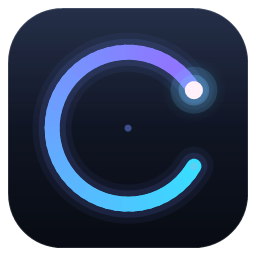

<div align="center">



# 时迹 TimeTrace

[](https://github.com/moranzj/TimeTrace/actions/workflows/ci.yml)
[](https://github.com/moranzj/TimeTrace/releases)
[](LICENSE)

**本地优先的个人活动追踪器** — 看看你的时间都去哪儿了

每 10 秒记录前台应用与截图 · 每 10 分钟活动总结 · 日报 / 周报 · 可选 AI 解读 · 本地网页面板

[功能](#功能特性) · [安装](#安装) · [使用](#快速使用) · [隐私](#数据与隐私) · [FAQ](#常见问题) · [English](README.en.md)

</div>

---

> 📌 **认准作者 [@moranzj](https://github.com/moranzj)** —— GitHub 上同名项目较多（CLI 工具、移动端应用等，均与本项目无关）。搜索「TimeTrace」时认准作者 **moranzj**；本仓库是 **Windows / macOS / Linux 桌面端**的**本地活动追踪器**（local-first activity tracker & screen-time journal）。

## 功能特性

- 🔍 **自动记录**：每 10 秒记录当前前台应用、窗口标题、空闲时间，并可全屏截图（同画面自动去重，不重复落盘）
- 🧠 **活动总结**：每 10 分钟汇总一次（活跃/空闲时长、应用切换、最长专注），可选叠加 AI 解读
- 📄 **日报 / 周报**：自动生成 Markdown 报告，跨天固化，含应用排行与 AI 建议
- 📊 **本地网页面板**（`127.0.0.1`，仅本机可访问）
  - 今日：活跃时长、**较昨日对比**、应用排行、每小时活跃、十分钟总结时间线、截图墙
  - 此刻：正在使用的窗口、空闲状态与**已持续时长**，状态灯实时刷新
  - 本周：每日一览、周排行、**🔥 活跃热力图（近 12 周）**、AI 周报
  - **💬 问一问**：用自然语言向 AI 提问你的时间数据（"今天我最专注的时段是几点？"）
- 🤖 **AI 可选**：兼容任意 OpenAI 格式端点（Ollama / LM Studio / OpenAI / OpenRouter / 本地网关…），全部免费模型也能用；不配置 AI 时其余功能完全可用
- 🧹 **自动清理**：截图按天/按容量滚动保留，原始日志可设保留天数
- 🔒 **数据不出本机**：截图与日志只存在本机磁盘；只有开启 AI 时才会把**文字统计**发给你配置的模型

## 平台支持

| 平台 | 状态 | 说明 |
|---|---|---|
| Windows 10/11 | ✅ 已实测 | `native/capture.cs` 编译为 capture.exe（用系统自带 csc.exe，无需安装运行时） |
| macOS 12+ | 🧪 可用 | 使用系统自带 `screencapture` / `osascript` / `ioreg`；需授予辅助功能与屏幕录制权限 |
| Linux (X11) | 🧪 可用 | 需要 `xdotool`（窗口信息）+ `scrot`/`import` 等（截图）+ `xprintidle`（空闲） |
| Linux (Wayland) | ⚠️ 部分 | 截图可用（`grim`/`gnome-screenshot`），窗口标题受系统安全限制可能读不到 |

> 唯一运行前提：**Node.js ≥ 18**（macOS/Linux 无需任何 npm 依赖；Windows 采集器用系统自带 .NET 编译）。

## 安装

从 [Releases](../../releases) 下载对应平台的压缩包，或 `git clone` 本仓库。

### Windows

1. 解压后双击 **`install.cmd`**（或 PowerShell 运行 `.\install.ps1`）
2. 自动完成：编译采集器 → 注册开机自启 → 创建桌面图标「时迹 / 停止时迹」→ 启动并打开面板

### macOS

```bash
tar -xzf timetrace-*-macos.tar.gz && cd timetrace-*
./install.sh
```

- 首次运行后，到 **系统设置 → 隐私与安全性** 给终端（或 Node）授予：
  - **辅助功能**（读取窗口标题，没授权则只记录应用名）
  - **屏幕录制**（截图，没授权则跳过截图）
- 会创建 `~/Applications/TimeTrace.app`（点开即启动并打开面板）与登录自启（LaunchAgent）

### Linux

```bash
tar -xzf timetrace-*-linux.tar.gz && cd timetrace-*
./install.sh
```

按 `timetrace doctor` 的提示安装系统工具：

```bash
# Debian / Ubuntu
sudo apt install xdotool xprintidle scrot imagemagick
# Fedora
sudo dnf install xdotool xprintidle scrot ImageMagick
# Arch
sudo pacman -S xdotool xprintidle scrot imagemagick
# Wayland 会话建议
sudo apt install grim
```

## 快速使用

```bash
timetrace install          # 一键安装（自启 + 桌面集成 + 启动）
timetrace web              # 打开面板（未运行则自动启动）
timetrace status           # 状态与今日概览
timetrace stop / start     # 停止 / 启动记录
timetrace doctor           # 环境体检（缺什么工具会告诉你）
timetrace summary-now      # 预览当前 10 分钟总结
timetrace test-ai          # 测试 AI 链路
timetrace rebuild-day  2026-10-16    # 重建日报
timetrace rebuild-week 2026-W42      # 重建周报
timetrace uninstall [--purge]        # 卸载（--purge 连数据一起删）
```

没装全局命令时也可直接用 `node bin/timetrace.mjs <命令>`，或 `npm install -g .` 安装全局 `timetrace`。

Windows 上还保留了原汁原味的 `start.vbs` / `stop.ps1` / `status.ps1`（桌面图标内部使用的就是它们）。

## 数据与隐私

- 所有数据都在项目目录内：
  - `data/logs/raw/` — 每 10 秒一条记录（JSONL）
  - `shots/` — 截图（默认滚动保留，见下）
  - `data/summaries/` — 十分钟总结；`data/reports/` — 日报 / 周报
- 截图清理策略在 `config.json` / `config.local.json`：`retention.screenshotDays`（按天）+ `retention.maxScreenshotGB`（按容量，超出自动删最早的）
- **AI 只发送文字统计**（应用名、时长、总结摘录），**从不发送截图**
- 面板只绑定 `127.0.0.1`，不对外网开放

### 配置分层

- `config.json` — 默认模板，随仓库分发，勿放个人信息
- `config.local.json` — 你的本机设置（会被 `.gitignore` 忽略），覆盖模板中的对应项

## AI 总结（可选）

在 `config.local.json` 里配置任意 OpenAI 兼容端点即可，例如本地 Ollama：

```json
{
  "llm": {
    "enabled": true,
    "baseURL": "http://127.0.0.1:11434/v1",
    "model": "qwen2.5:7b",
    "timeoutSeconds": 45,
    "minuteSummary": true,
    "daySummary": true,
    "weekSummary": true
  }
}
```

- 云端也行：填 `baseURL`（如 `https://api.openai.com/v1`）、`model`，密钥写 `apiKey` 或 `apiKeyFile`（指向存密钥的文件）
- 支持 `fallbackModels`：主模型失败时自动按顺序尝试备用模型
- 不配置 AI 时，总结/报告使用纯模板统计，功能完整可用

## 目录结构

```
bin/timetrace.mjs    跨平台 CLI（安装 / 启停 / 体检）
daemon.mjs           守护进程：采集调度、总结、报告、面板服务
lib/                 dashboard（面板+API）· report（统计/报告）· llm（AI）· config · platform
native/capture.cs    Windows 采集器（csc 编译，Win32 API 实现）
native/capture.mjs   macOS / Linux 采集器（系统自带命令实现）
web/index.html       单文件网页面板（无外部依赖）
tools/               图标生成、语法检查、单元测试
tests/               node --test 单元测试
```

## 常见问题

**面板打不开？** 运行 `timetrace doctor` 看缺什么；或查看 `data/run/daemon.log`。

**Wayland 下没有窗口标题？** 这是 Wayland 的安全模型限制（X11 会话功能完整）。截图在 Wayland 下仍可用（grim / gnome-screenshot）。

**macOS 只记录到应用名、没有标题？** 去「系统设置 → 隐私与安全性 → 辅助功能」勾选终端/Node；截图需额外勾「屏幕录制」。

**端口被占用？** 改 `config.local.json` 里的 `dashboard.port` 后 `timetrace restart`。

**开机自启装在哪？**
- Windows：任务计划程序里的 `ActivityTracker`
- macOS：`~/Library/LaunchAgents/com.timetrace.agent.plist`
- Linux：`~/.config/autostart/timetrace.desktop`

**换电脑迁移数据？** 拷贝 `data/` 和 `shots/` 两个目录即可。

## 开发

```bash
npm test        # 语法检查 + 单元测试（node:test，零依赖）
npm run doctor  # 本机环境体检
```

- 代码全部为纯 ESM、零运行时依赖；新增功能请附带 `tests/` 里的单元测试
- 图标：`tools/makeicon.cs`（Windows csc 生成 ico/png）→ `node tools/make-icons.mjs`（打包 .icns）

## 许可

[MIT](LICENSE)
